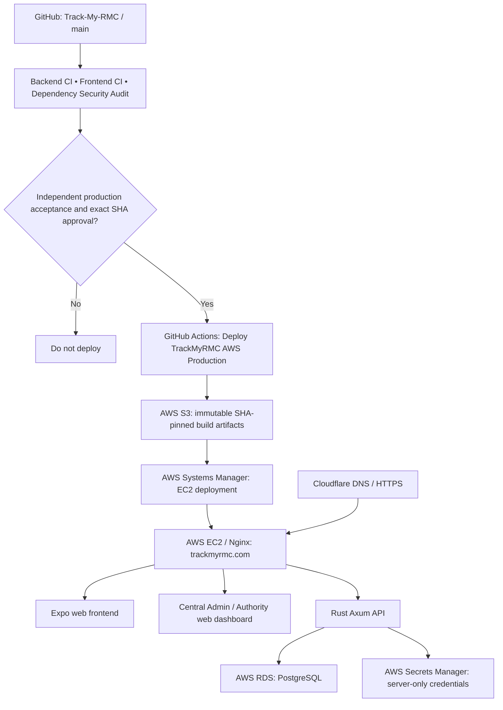

# TrackMyRMC

TrackMyRMC is an RMC (ready-mix concrete) operations platform with a Rust/PostgreSQL API, an Expo/React Native client and a separate privileged web dashboard. It covers customer enquiries and orders, plant onboarding, dispatch and driver trips, delivery evidence, quality, workforce and controlled internal automation.

**Implementation is not the same as production activation.** Some providers, payments, privileged account enrollment and automation workflows remain gated by independent release acceptance. Consult the release assessments before treating a feature as live.

## Repository layout

| Directory | Purpose |
| --- | --- |
| backend/src, backend/migrations, backend/tests | Rust Axum/Tokio/SQLx 0.8 API, PostgreSQL schema and regression tests |
| frontend/app, frontend/src | Existing Expo SDK 54 / React Native app, role journeys and shared components |
| frontend/modules | Native Android trip-location module and integrations |
| admin-web/src, admin-web/scripts | Vite/React privileged Central Admin and Authority workspace and browser checks |
| ops, ops/tests, ops/release | AWS release scripts, security checks and operational procedures |
| .github/workflows | Backend/frontend/Android CI and independently gated AWS release |
| docs | API contracts, role policy, payments, automation and release evidence |

## Roles and security boundary

- Customers and drivers use their intended application sign-in flows; plant owners and scoped staff have separate entitlements and session controls. Do not create additional application roles to grant platform access.
- **Central Admin** is a web-only privileged identity with approved session provenance, password and authenticator MFA. Global controls and sensitive status mutations need explicit permissions and, where required, fresh MFA.
- **Authority** is a separate web-only identity. Central Admin may grant only allowlisted capabilities. Platform support access uses explicit support.view; replies and private notes additionally need support.reply. Authority cannot grant privileges, manage global automation or close/reopen support cases.
- Platform support follow-ups are separate from plant-scoped native automation. Only approved, credential-ready web operators can receive internal reminders. Generic mobile notification endpoints do not grant access to those reminders.
- No authentication, KYC, payment or worker feature should be enabled simply because a pull request passed CI.

See [Central Admin / Authority contract](docs/security/central-admin-authority-control-plane.md), [Support authorization and acceptance](docs/security/pr159-release-acceptance.md) and [Role permission matrix](docs/ROLE_PERMISSION_MATRIX.md).

## Local development

Use an **isolated local PostgreSQL database**; do not point local development or migration tests at production.

**Requirements:** supported stable Rust toolchain, PostgreSQL 16 or 18, Node.js 20+ and npm. The tracked lockfiles govern package resolution. Node 20 is used by current frontend CI.

Backend (run from repository root):

~~~bash
cp backend/.env.example backend/.env
# Set local DATABASE_URL and any test-only provider configuration.
cd backend
cargo fmt --all -- --check
cargo check --all-targets
cargo clippy --all-targets --all-features -- -D warnings
cargo test --all
cargo run
~~~

The backend reads backend/.env when started from the backend directory, verifies configuration, then **runs pending SQLx migrations on startup**. Production configuration requires valid PostgreSQL TLS and explicit HTTPS CORS origins. Do not reuse development secrets in production.

Health endpoint: http://localhost:8000/health (returns a JSON status and database connectivity). Existing production URL: https://trackmyrmc.com/health.

Expo client:

~~~bash
cd frontend
npm ci
# Set EXPO_PUBLIC_BACKEND_URL to your intended API origin.
npm run typecheck
npm run check:auth-routing
npm run check:modules
npm run check:play-policy
npm run build:preview
npm run start
~~~

Native background location and payment SDK workflows require device-specific builds; browser export alone is not device acceptance. Configure Android Maps keys with correct restrictions before a signed release.

Privileged admin web:

~~~bash
cd admin-web
npm ci
cp .env.example .env.local
# Verify .env.local contains VITE_API_URL=http://localhost:8000.
npm run dev
# npm run build also validates the admin bundle locally
~~~

This development server is not a substitute for real web-MFA enrollment and scoped role acceptance.

## Production hosting and release flow

**One source repository:** [`Aakruti7870/Track-My-RMC`](https://github.com/Aakruti7870/Track-My-RMC). **One production target:** AWS. No Render runtime, database or Render Blueprint is part of the release.

**Canonical website:** `https://trackmyrmc.com`. Its Nginx instance serves the Expo web frontend, the separate privileged web UI, and proxies `/api/` to the locally running Rust service. The backend uses AWS RDS PostgreSQL and Secrets Manager. Build the mobile Android app from the same repository but release it separately through the signed AAB and Play approval process.

**Hostname routing:** Cloudflare has an enabled HTTP 301 redirect rule for `www.trackmyrmc.com` to `https://trackmyrmc.com` (preserving path and query), and the proxied `www` CNAME now targets `trackmyrmc.com`, not Render. The redirect and DNS records were verified through Cloudflare's API; an independent external HTTP redirect smoke test is still required before claiming every visitor path is verified.

**Render separation:** Historical Render static-site/backend deployments are *not* part of the approved AWS release. The two obsolete backend Blueprints (`render.yaml`, `backend/render.yaml`) have been removed from the source tree. An independently configured Render dashboard service may still auto-deploy on `main`; deleting YAML does not disconnect or delete such services. Retire their Git auto-deploy / dashboard resources separately after confirming domain traffic no longer reaches Render.

**Live KYC:** authenticate and poll DigiLocker through the same Test/Live host selected by the server; use the browser return URL only for navigation. KYC stays disabled until Live-provider entitlement, controlled consent tests, and independent production release acceptance are confirmed. See [Live DigiLocker release contract](docs/release/digilocker-live-activation-20261105.md).

## CI and release

- Backend CI: Rust format, check, strict Clippy, PostgreSQL 16/18 integration/security tests, operator bootstrap fixtures and browser/Expo journey regressions.
- Frontend CI: TypeScript typecheck, role/asset/security guards, Expo web bundle, browser layout regressions and admin web build.
- Android build and Play reviewer verification are separate release concerns; a successful web export is **not** a signed AAB or Play Console approval.
- AWS production uses EC2 + Systems Manager, RDS PostgreSQL, S3 release artifacts and GitHub Actions. The deployment workflow requires successful push CI for the **exact main commit SHA** and an independently approved matching TRACKMYRMC_APPROVED_RELEASE_SHA value. Green PR checks or merging alone must not trigger deployment.
- Application startup applies migrations. Before an authorized deployment, verify production migration parity, TLS and scoped operator access and retain a tested recovery plan. Do not change live DB history to force parity.
- NATIVE_AUTOMATION_WORKER_ENABLED and NATIVE_SUPPORT_AUTOMATION_ENABLED must stay **false unless separately approved**. Enabling the general worker can activate other governed automation; the support worker requires both switches true.

For detailed procedures consult [Deployment guide](docs/DEPLOYMENT.md), [Production release assessment](docs/security/pr157-release-assessment.md), [Native support follow-ups](docs/native-support-automation.md), [Closed-loop automation](docs/native-automation-closed-loop.md) and [RMC payments safeguards](docs/payments/RMC_PREPAID_PLAY_COMPLIANCE_AND_ROLLOUT.md).

## Current acceptance and limitations

Customer-to-plant Cashfree prepaid checkout is provider-gated; do not enable live payments or owner subscriptions based on sandbox code. DigiLocker/KYC provider readiness, permanent privileged identities, Google Play declarations, real-device workflows and production automation require their own acceptance evidence. Historical reports in docs may describe earlier PR states; rely on current GitHub CI and an explicitly dated release assessment for the selected SHA.

Report issues with the affected role, route, exact commit, reproduction steps, expected/actual result and sanitized logs. Never post tokens, customer records, OTPs, database URLs or live secrets into issues.
