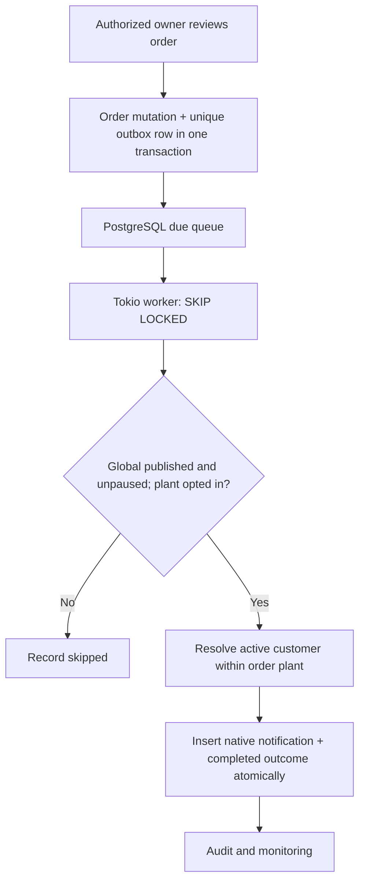

# Native Automation: Controlled Foundation (Draft)

## Scope and provenance
This is a TrackMyRMC-owned Rust/SQLx/Tokio implementation. The workflow/approval concepts were
reviewed against `Aakruti7870/Marketing-API-Rust`, but its generic HTTP_REQUEST/WHATSAPP
nodes, workspace `SYSTEM_ADMIN` override, and non-atomic scheduler were **not** copied.
There is no network dependency on Marketing-API-Rust, Redis, n8n, Vapi, or Zapier.

## Security boundaries
- Only the **dedicated Central Admin** web MFA session can change global template policy;
  this also requires explicit `automation.manage` and a fresh step-up challenge.
- Only an **active Plant Owner** can opt in/out for their own active plant. Managers and
  other staff cannot change these settings, regardless of delegation.
- Templates are predefined and initially unpublished/paused. Plant settings are
  initially absent (deny). `NATIVE_AUTOMATION_WORKER_ENABLED=true` must be set only after
  controlled migration, testing, rollout approval and owner opt-in.
- Worker executes only built-in internal notifications. It cannot mutate orders, approve
  payments, issue refunds, run arbitrary SQL/scripts or make outbound HTTP requests.
- Existing order-create owner alerts are unchanged: this slice adds only customer
  notifications following an authorized *order approval/rejection*.
- No external marketing/broadcast messaging is executed.

## Flow

## Existing interfaces preserved
The original `/api/automation/events/*` endpoints, migration 0018, API compatibility,
role login behavior, Expo frontend and Admin web UI are not removed or rewritten.

## Additive APIs
- `GET /api/control-center/automation/templates` — Central Admin with `system.view`.
- `POST /api/control-center/automation/templates/:template_key/policy` — dedicated Central Admin, `automation.manage`, recent step-up.
- `GET /api/control-center/automation/jobs` — dedicated Central Admin with `audit.view`.
- `GET /api/control-center/automation/health` — dedicated Central Admin with `system.view`.
- `GET /api/owner/plants/:plant_id/automation/rules` — own active plant only.
- `PUT /api/owner/plants/:plant_id/automation/rules/:template_key` — active Plant Owner only.

## Further work before user-facing launch
1. Complete CI on PostgreSQL 16/18, including migrations, Rust fmt, check, Clippy and tests.
2. Add isolated service tests of global policy and owner endpoint authorization.
3. Add explicit Central Admin permission assignment/revocation UI, owner settings UI,
   and a read-only execution-history screen with no new login roles.
4. Expand versioned, centrally reviewed templates to RFQ, dispatch, workforce and quality,
   using durable scheduled jobs, action typing, failure remediation and human approvals.
5. Authority Broadcast Center is **out of scope here**: dedicated Authority authentication
   and workspace acceptance must be completed before granting broadcast access. A future
   separate controlled PR may reuse contact/segment/offer ideas, with marketing consent
   and approved WhatsApp templates; do not inherit Marketing-API-Rust's unsafe direct-send path.
6. Do not merge or deploy until an explicit release decision and production preflight.
