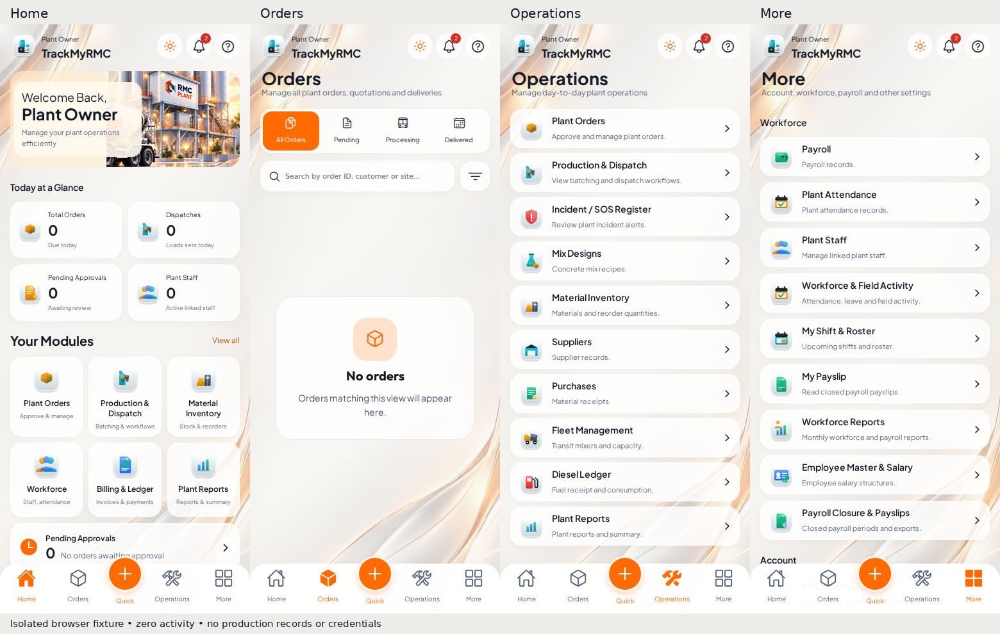
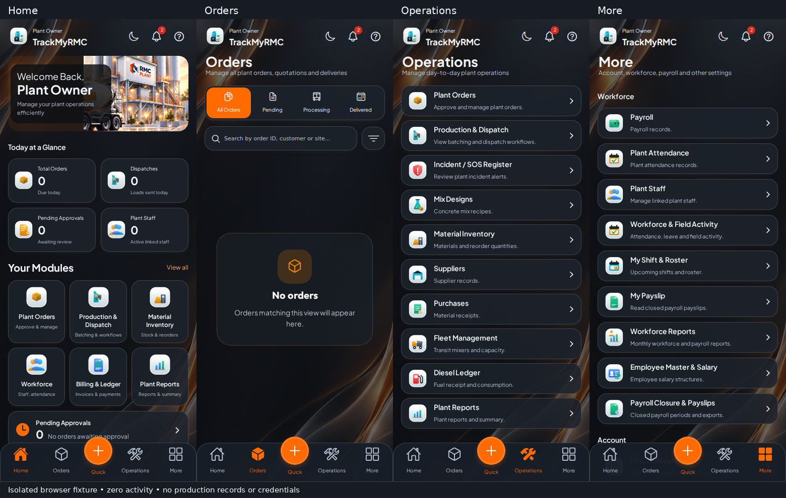

# Plant Owner redesign review

Owner-only implementation for `/owner`, `/owner/orders`, `/owner/operations` and `/owner/more`. Awaiting preview approval; this branch must not be merged or deployed before approval and green CI.

## Preview evidence

These are screenshots of the compiled Expo application, with API responses intercepted only by the browser test process. Zero-activity screenshots deliberately show empty orders and zero counts. The separate order-card screenshots use an explicitly named `TEST-OWNER-001` fixture. No fixture data, preview bypass, or fabricated trends are present in application code. Before screenshots use the same zero-activity fixture against baseline `9d06c27`.

- [Four light screens](previews/light-overview.webp)
- [Four dark screens](previews/dark-overview.webp)
- [Before redesign](previews/before-overview.webp)
- [Desktop screens, 1440px viewport](previews/desktop-overview.webp)
- [Light order-card fixture](previews/orders-light-fixture.webp)
- [Dark order-card fixture](previews/orders-dark-fixture.webp)

## Preserved routes and behavior

[Route inventory](route-inventory.md) lists all 30 catalog destinations. Operations contains ten, More contains the remaining twenty, and Driver Onboarding remains available as a 31st destination. Home → View all opens the complete directory. Home exposes six principal shortcuts. The former quantity metrics, connected plant count and weekly chart remain available through the expandable Plant Overview & Weekly Insights on More.

Production & Dispatch now opens the existing order queue with a processing filter rather than linking back to Operations. Orders keep the original `/order/[id]` details and mutations. Pending/processing/delivered are read filters that map to persisted backend states; they do not rewrite business states. Cancelled/rejected and draft orders remain discoverable through filters and All Orders.

Home shows orders due today, loads dispatched today, all pending approvals and distinct active linked staff. Comparison badges are omitted. The existing plant-scoped read query receives additive counts only. Orders use parameterized search, delivery dates, plant, grade and status with bounded pages; unparameterized legacy callers retain the original 500-record limit.

The owner guard, legacy role alias, authentication, reviewer login, salary permissions, KYC provider integration, other dashboards, business mutation endpoints and database schema are unchanged. Owner-only warm artwork recoloring preserves uploaded SVG geometry and leaves other role artwork untouched.

## Validation

- TypeScript: pass.
- Changed-file ESLint: no new warnings; repository lint retains existing warnings.
- Module discovery, all 91 vector assignments, role routing and Play policy checks: pass.
- Android responsive and permission guards: pass.
- Expo production web export and Android JS/assets export: pass.
- Rust formatting, all-target check, Clippy with warnings denied, and owner status unit test: pass.
- PostgreSQL 16 and 18 tests on the first source revision: pass, including owner pagination/search/tenant integration test. Current revision CI is linked in PR #95.
- Browser tests: pass at 320, 390, 768 and 1440px, including light/dark, all 31 directory entries, six Home shortcuts, ten Operations rows, Quick preserving the active page until selection, search/filter request parameters, order-detail navigation, server error state, theme persistence and the last Operations row above bottom navigation.

## Limits and review notes

A signed native APK/AAB and physical Android device session have not been produced in this environment. Android validation covers the Expo Android export and repository layout/permission guards. Browser previews do not establish live production-data correctness, production reviewer credentials, or native hardware Back behavior. Real authenticated multi-role journeys and database isolation are covered by the repository's GitHub Actions fixtures. Existing shared detail screens retain their established design and logic.

No production visit requiring sign-in, merge or deployment has been performed. After approval, all required CI checks must be green before merging and verifying the actual AWS deployment.
