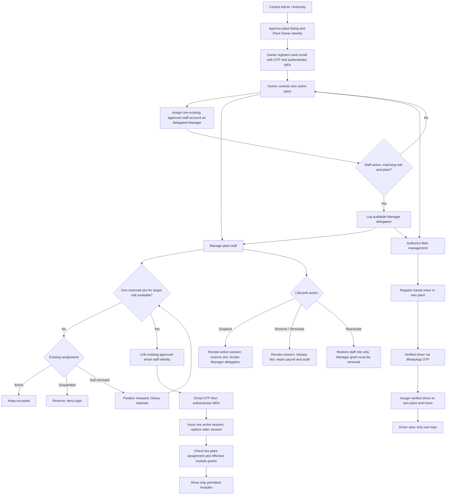

# TrackMyRMC — controlled plant access and employee lifecycle

**Status:** PR review only. Do not merge/deploy until PR #141 recovery and security acceptance gates pass.

## End-to-end decision flow

## Permission matrix

Roles below are server-side job roles. The **Plant Manager designation is not a login role**: an Owner grants it to one already-active employee in one of the seven existing roles. A Manager retains the underlying job permissions.

| Role | Default view | Default edit / actions | Owner-controlled limits |
| --- | --- | --- | --- |
| Central Admin / Authority | Global compliance, owner assignments, oversight | Approve/assign Plant Owner via separately authorized admin flows | No assumed plant operational access; requires privileged step-up |
| Plant Owner | Own plant, orders, operations, staff, financials and fleet | Appoint/revoke Manager; link, suspend, reactivate, remove staff; assign permitted module grants; register TM and driver | Cannot access another plant |
| Delegated Plant Manager | Own plant staff directory and employee modules | Manage **other** non-manager staff: link, suspend, reactivate, remove and adjust within role ceilings; driver onboarding | Cannot edit own assignment, another Manager, owner role or Manager delegations |
| Dispatcher | Dispatch, fleet, challans; inventory read | Dispatch loads / fleet assignments; gate pass | No billing, payroll or approvals |
| Plant Operator | Production queue, approved mixes, inventory | Batch production and allowed challan preparation | No finance or HR management unless separately delegated |
| Supervisor | Production, incidents, workforce, quality read | Manage production/incidents as permitted | No finance / Manager access unless explicitly delegated |
| Accountant | Billing, ledger, expenses, rates and payroll | Approved accounting and payroll preparation operations | No dispatch; payroll approval ceiling remains separate |
| Quality Engineer | Quality register, mix designs and related stock | Record tests/mixes/challan as permitted | No billing or dispatch assignment |
| Fleet Manager | Fleet, drivers, diesel and dispatch | Manage fleet / driver roster with effective role grant | No staff management unless separately delegated |
| Store Manager | Material inventory, suppliers, purchases, diesel | Stock updates, procurement and authorized diesel records | No payroll or staff management unless separately delegated |
| Driver | Own allocated trips and profile | WhatsApp OTP, GPS, assigned trip status, POD / signature | No employee management or other drivers' trips |
| Customer | Own orders, quotations, sites and KYC | Customer-specific RFQ/order operations | No plant administration |

View/edit/approve details are enforced by `staff_module_permissions::role_ceiling` and Owner-configured overrides. UI links never grant API permissions.

## One-slot contract and employee states

* **Seven existing staff roles, one reserved slot per plant per role.** A suspended employee reserves the slot.
* **Remove Assignment** is the only operation that releases a role; it revokes the employee's active session and preserves payroll and audited history.
* **Exactly one active delegated Manager per plant** (independent of job role). Only the owning Plant Owner appoints or revokes the delegation.
* A Manager cannot promote another Manager or modify their own assignment. Removing/suspending a Manager automatically revokes the delegation; reactivation does not restore it.
* Existing frontend Staff Management still links an already-registered staff UUID; separate email-based staff invitation/provisioning is **not** implemented by this change. Seven audit aliases forwarding to `support@trackmyrmc.com` are not yet verified live accounts.
* Fleet Manager may access driver employment records only through the `driver_roster` effective view/edit grant; managers must have a live Owner delegation. Each Driver identity remains verified through WhatsApp and plant scoped.

## API and data additions

* `GET /api/staff/manager-access` — current staff member's live delegation.
* `POST /api/business/plants/:plant_id/staff/:user_id/manager/grant` — owning Plant Owner only.
* `POST /api/business/plants/:plant_id/staff/:user_id/manager/revoke` — owning Plant Owner only.
* Staff lifecycle routes remain under `/api/business/plants/:plant_id/people/:user_id/*`; mutations now authorize Owner or delegated Manager, with self/manager-target restrictions.
* Migration `0045_plant_staff_manager_delegations.sql` introduces a plant-staff-bound delegation and a database-enforced one-manager-per-plant uniqueness rule. Grant, revoke and automatic revoke create audit entries.

## Remaining external acceptance gates (do not auto-merge/deploy)

1. **Owner approval role mapping:** existing plant-onboarding approval is guarded by mobile `admin`; the separate Central Admin/Authority identity requires an explicitly reviewed bridge. Do not treat those identities as interchangeable or weaken that guard.
2. Verify interactive staff/Manager onboarding, distinct email OTP deliveries and individual MFA with live providers; signed Android/iOS test and role-denial cases.
3. Verify staff Manager delegation UI, per-role effective permissions, cross-plant denial, Manager self-action denial, slot conflicts and driver PII restrictions on test fixtures.
4. Confirm an approved fresh encrypted RDS backup and **isolated restore/rollback drill**, then reconcile runtime `postgres` versus documented RDS database `trackmyrmc` with the operator; they must not be silently switched.
5. Independent security review and explicit production release approval. PR #141 merges may auto-deploy migrations 42, 43 and 45. Never merge automatically.
