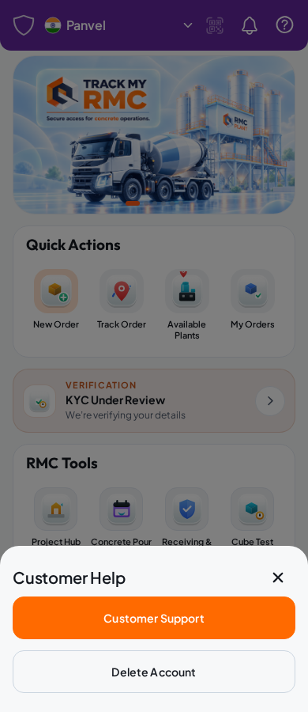
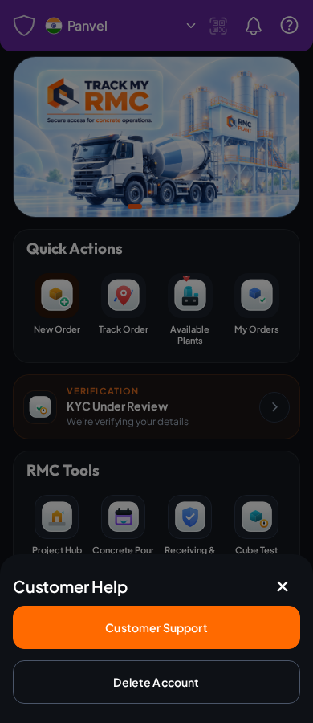

# Customer Home header

The approved header replaces only the Customer Home wordmark/status row. Existing Home modules and artwork are unchanged.

- Purple in both themes; five controls with a flexible, truncating city label and 44 × 48 minimum icon targets.
- KYC comes from authenticated `/me`; a failed status refresh produces a neutral indicator. No document data is rendered.
- Unread state comes from `/notifications?limit=1`. Focus, foreground, native push arrival and visible-screen polling refresh the status; existing backend read actions remain authoritative.
- Location respects existing consent, uses one foreground fix, and resolves a city through authenticated `/maps/geocode`. Manual city/locality/PIN lookup uses the same endpoint. Missing configuration, provider failures, denied permissions and GPS failure never produce a fabricated city.
- QR is disabled. Help contains only Customer Support and Delete Account.
- Signed-in deletion now requires a fresh, single-use, deletion-purpose OTP for the current database user's role-appropriate contact plus `DELETE`. It records the existing cancellable deletion request and preserves retention processing. Public deletion code delivery now uses the deletion-specific endpoint too.

## Rendered evidence

Captured from the real Expo web build with isolated synthetic API fixtures. These images are not live customer data. Header colors intentionally stay the same in both themes.

| Light | Dark |
| --- | --- |
|  |  |
|  |  |

## Validation

`frontend/scripts/test-customer-header-browser.cjs` runs with the existing admin-web Playwright dependency after exporting and serving the frontend on port 8765. It checks 320, 390, 768 and 1440 px in both themes, control geometry, backend KYC transitions, unread/read synchronization, denied/timed-out location and lookup retry, support navigation/session preservation, and deletion confirmation controls. GitHub Frontend CI runs it and uploads `customer-header-theme-previews`.

Rust coverage includes geocode validation/provider failure handling and a PostgreSQL handler regression for wrong-purpose, wrong-account, invalid and reused deletion codes. No database migration or new runtime dependency is required.

Actual Android device/emulator rendering and live Google geocoding require a device and configured provider; web viewport checks and native bundle exports do not substitute for those checks.
